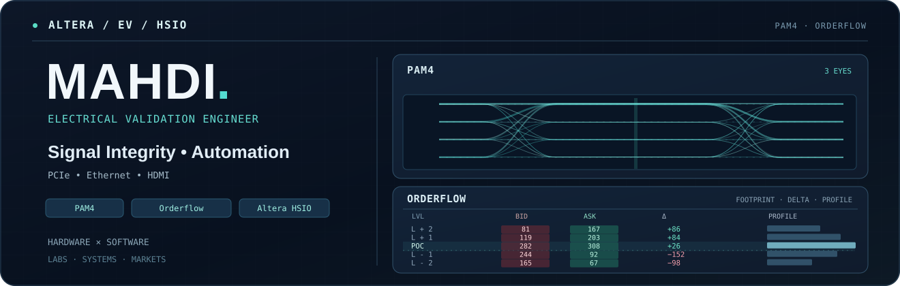

  
  
<samp><b>ALTERA / EV / HSIO</b> &nbsp; · &nbsp; Electrical Validation &nbsp; · &nbsp; Hardware × Software</samp>

 

  
<samp><b>01 / ABOUT</b></samp>

  
<samp>🔬 &ensp; <b>WORK</b> &nbsp; — HSIO validation: PCIe, Ethernet, HDMI, and signal integrity.</samp>

  
<samp>🛠️ &ensp; <b>BUILD</b> &nbsp; — Test automation, lab infrastructure, and AI-assisted engineering.</samp>

  
<samp>📈 &ensp; <b>EXPLORE</b> &nbsp; — Orderflow, market profile, trading systems, and backtesting.</samp>

  
<samp>🎓 &ensp; <b>EDUCATION</b> &nbsp; — M.S. ECE @ CU Boulder | B.S. CS @ SF State.</samp>

  
<samp>⚽ &ensp; <b>OFF HOURS</b> &nbsp; — Soccer, drifting, and all things automotive.</samp>

