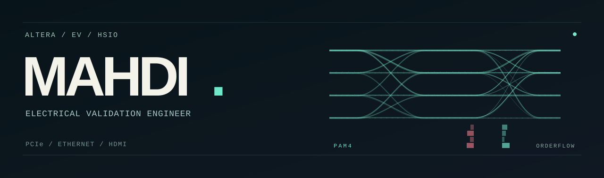

  

 

<samp><b>ALTERA / EV / HSIO</b> — PCIe, Ethernet, HDMI &amp; signal integrity.</samp>

<samp><b>BUILD</b> — Hardware/software automation, lab tooling &amp; AI-assisted workflows.</samp>

<samp><b>EDUCATION</b> — M.S. ECE @ CU Boulder | B.S. CS @ SF State.</samp>

<samp><b>OFF HOURS</b> — Orderflow, trading systems, soccer &amp; drifting.</samp>

<samp>Other visual directions</samp>

<samp><a href="./designs/README.md">Explore the four banner concepts</a></samp>

