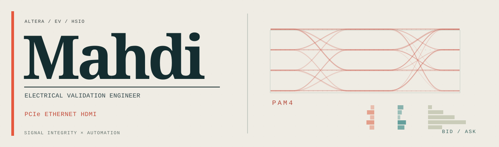
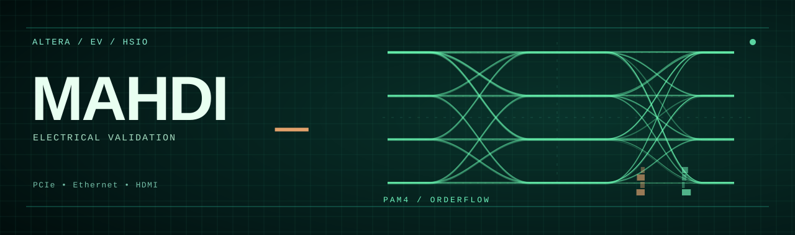
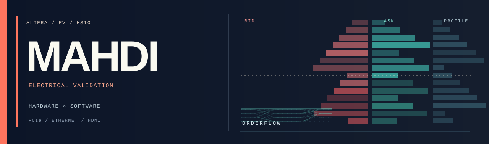

# Profile banner studies

Four independent visual directions for `Mahdi451`, built as editable SVG assets. Each is 1280 × 380 and can replace the top-level README image without changing the bio.

## 01 — Signal Signature

**Quiet, dark, understated.** Oversized wordmark and a luminous four-level PAM4 eye with a small orderflow accent. Most distinctive for a personal engineering identity.


## 02 — Editorial Print

**Warm, typographic, analog.** Paper-white ground, oversized serif name, rust-colored signal traces, and an asymmetric composition.



## 03 — Phosphor Scope

**Oscilloscope nostalgia.** A restrained phosphor-green graticule, glowing PAM4 transitions, and a subtle nod to market microstructure.



## 04 — Orderflow Poster

**Bolder, market-first.** Graphic footprint imbalances, volume-profile bars, a coral accent, and an architectural poster layout.



---

## Selecting a header

Update the first image in the top-level `README.md` by changing only its `src` to one of these paths:

```text
./assets/concepts/01-signal-signature.svg
./assets/concepts/02-editorial-print.svg
./assets/concepts/03-phosphor-scope.svg
./assets/concepts/04-orderflow-poster.svg
```

Option 01 is preselected in the proposed README. All four are stored in the repository, so choosing another requires a one-line change. SVGs are self-contained and do not depend on external image hosts.
